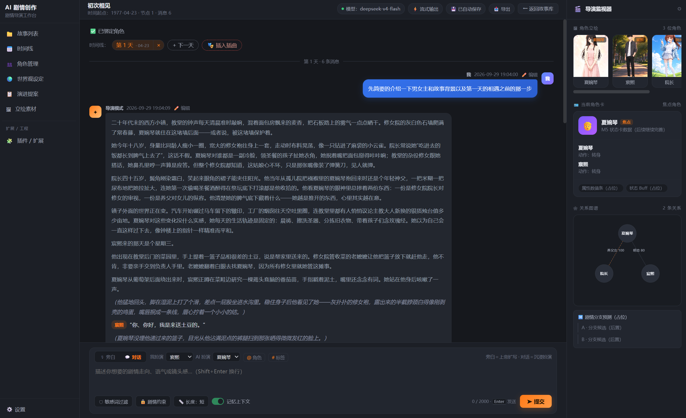
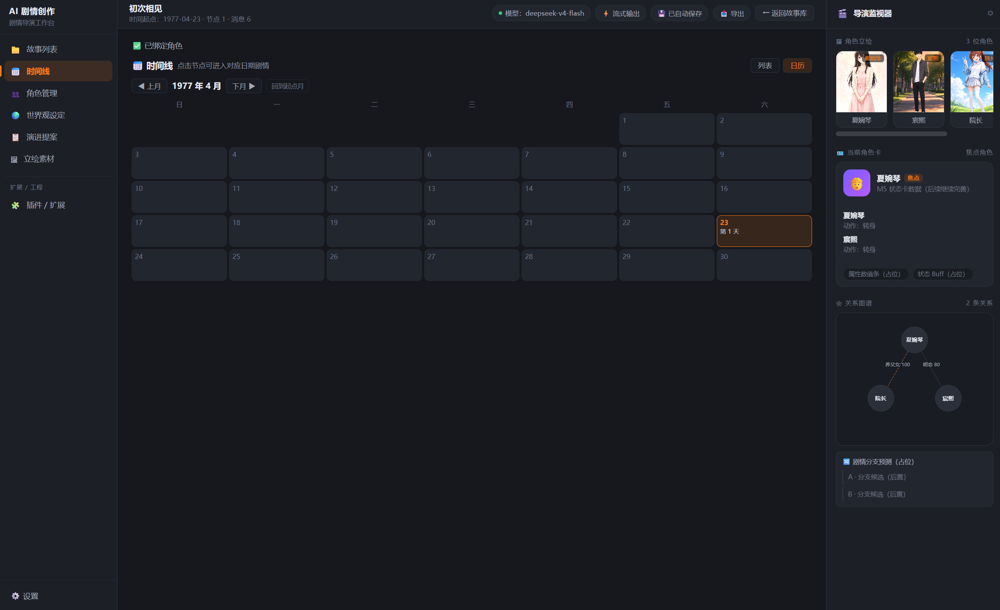
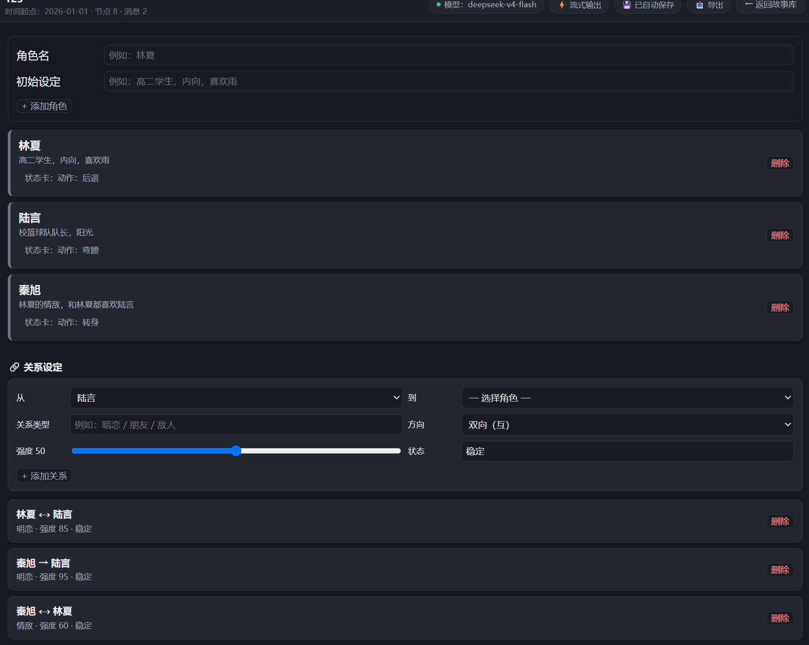
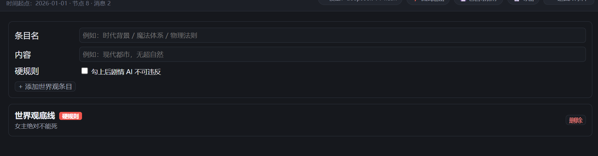
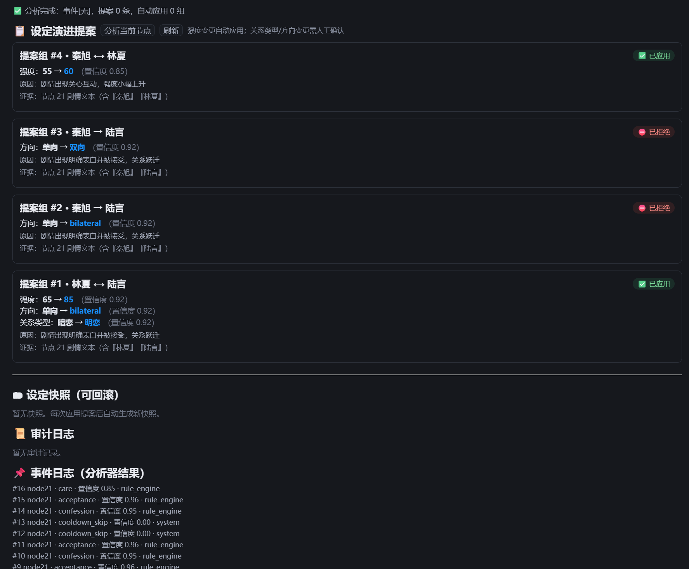
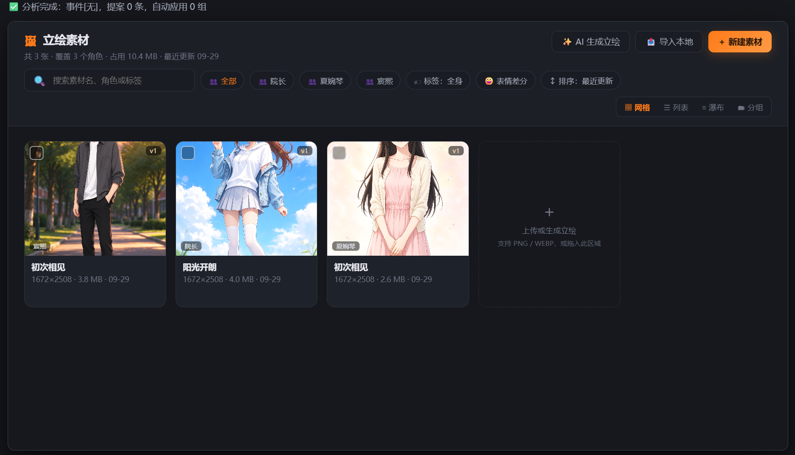

# 织梦机（Story-Weaver）· AI 原生叙事引擎

[](LICENSE)
[](LICENSE-CONTENT)
[](#九版本记录)
[](https://tauri.app/)
[](https://react.dev/)
[](https://www.rust-lang.org/)

> **品牌：窗口标题 = 织梦机 · 左栏与打包名 = Story-Weaver**
> **当前版本：V3.16.0（2026-11-14）· **产物已打好、待发布**（MSI + 便携版在 `dist-package/`；tag 与 Release 由作者执行）· 许可：源码公开 + 非商业使用许可
> **版本规划：V1.x Windows 单机版**
> 端到端最小闭环：创建故事 → 设定时间起点 → 创建角色和世界观 → 写剧情 → 调用模型生成 → 按日保存 → 重启恢复 → 修改历史 → 基于修改续写 → 后台生成设定变更提案 → 人工确认 → 快照更新 → 可回滚。
> 当前阶段：**V3.16.0 待发布**（2026-11-14，产物已就绪）—— 自 v3.15.0 起 58 个提交（含 8 个依赖升级），三条主线：**对话模式改走「角色视角」**（她只知道自己该知道的事，旁白一个字没动）、**视角按「配对」算**（换扮演者会提示，旧对话不丢）、**新增「双池对比」**（两个视角差在哪，一眼看到；带漂移护栏）；安全侧顺带收了插件能力域授权、命令面审计、SQLite CVE 的运行期防线。没有新表、没有改表结构。
> 这一版具体改了什么、**验证到什么程度**（含可复现命令与「没覆盖的部分」）：[docs/user/releases/v3.16.0.md](docs/user/releases/v3.16.0.md)。

---

> **一句话定位**：本项目是一个**在本机运行的桌面创作工具** —— 不提供生成式 AI 服务、不代申请任何接口；
> **你的数据只在本机**（这一条我们只验证到源码层：没有指向作者自有服务器的地址、没有上报调用点 ——
> 运行时到底连了谁，请按 [docs/user/security/AGENT-AUDIT-GUIDE.md](docs/user/security/AGENT-AUDIT-GUIDE.md) §3.3 自己抓包）。
> 你自行配置模型与绘图服务，内容合规与标识义务由使用者承担。
> 使用 AI 绘图前建议先读左侧（软件内）「⚖ 合规与责任」页与 [责任边界与合规](#十一责任边界与合规)。

## 一、项目简介

**AI 原生叙事引擎**：通过结构化角色卡、世界书触发注入、动态数值系统和导演指令机制，在保持叙事一致性的前提下实现开放式互动叙事。

面向长文剧情创作的 Windows 单机桌面工具（核心关注故事本身的质量：结构、连续性、人物一致、伏笔能回收）。核心能力：

- **故事与时间线**：绝对时间起点、按日存储、日历视图、插曲/倒叙、历史修改与后续失效标记
- **角色与世界观**：角色库、关系图、世界观硬规则
- **剧情生成**：旁白 / 对话两态 · `*…*` 心声 · `#标签` 元指令 · `@角色` 聚焦 · `〔导演指令〕` · 流式输出（可中途停止）· **失败自动重试**（429 / 5xx 最多 3 次，只在还没吐字时重试）· **彻底失败保留半截 + 红字写原因**（导出剥掉）
- **上下文管理**：系统提示词→角色设定→关系图→世界观→最近 N 轮→用户输入；Token 估算与智能截断（只截断历史、超限自动降 N）· **回顾检索**：说「第 4 天」就只带第 4 天，未来天与前三天不给，「第 3 到第 5 天」这类范围用「🔍 回顾」多选
- **后台静默演进**：事件日志 → 候选事件提取 → 实质性判断 → 变更提案 → 校验 → 人工确认/拒绝 → 快照更新 → 可回滚
- **章节与大纲**：章 ↔ 天手动圈定（一天只属一章）· **章卡上的天可拖到别的章（或拖回「未归章」）** · 编辑章时能改「关联的天」· 按章导出全书 · 每章「目标」可注入生成（默认开、空目标零 token）· 统计卡（进度/字数/未归章/伏笔）
- **伏笔台账**：手标 + 规则扫描提议（可拒绝）· **本地模型扫原文，一批一章**（轮数 = 章数；前情摘要只带这一章的天 + 往前三天，不再把整本历史塞进去）· 逾期按章序现算 · 埋设章与计划回收章一眼可见
- **动态数值**：体力/理智/存在感（插件默认关）· 事件类走对话协议、作息走「日结」· **数值会压台词**：低理智只剩短句、低体力句子更短（每句字数与本段句数都有硬上限）· **体力还决定"做得到做不到"**：很低时力气活写失败或走形（搬不动 / 扶不住 / 走两步就得停），正常以上不许无端写虚弱 · 存在感正负各自封顶 ±5 · 普通的一夜恢复 +10 体力 · 每次变化可单条撤销 · 导演代价按故事日衰减（每 10 天 −5）
- **承诺状态**：从剧情提炼（多条并存）· 标记结算兑现/未兑现 · 记忆卡三态徽标可手改 · 关键记忆按祖先链继承（嵌套分支读得到父分支的承诺，兄弟分支互不可见）
- **本地模型（Ollama）**：插件页填地址 + 模型名 + 上下文档位，「检查连接」读版本、「测试对话」发一句验证（**走原生 `/api/chat` 并关思考** —— 思考型模型不再永远回空，空时会说清原因）；开着时主模型走本地（**原生 `/api/chat`，档位真的作为 `num_ctx` 发过去，结束块还能拿到真实用量**；**不下载、不启动 Ollama，也不做失败回落**）
- **设置与安全**：API Key 存系统钥匙串（不落剧情文件夹）、缓存管理、日志与调试面板

详细规格见 [docs/dev/SPEC.md](docs/dev/SPEC.md)，文档总入口 [docs/README.md](docs/README.md)。

## 二、技术栈（已确认落地）

| 层 | 技术 |
|------|------|
| 桌面壳 | Tauri 2（Rust 核心） |
| 前端 UI | React + TypeScript + Vite（深色 STORY DECK 主题，内联样式） |
| 数据库 | SQLite（sqlx），story.db / library.db |
| 状态管理 | React useState / 组件内状态（未引入状态库） |
| Token 估算 | 按字符类别加权（汉字 0.79 / 英文 0.20 / 空白 0.12 / 标点 0.39），按真实 usage 校准；前后端同一套系数 |
| 网络 | reqwest + tokio |
| 钥匙串 | keyring（Windows Credential Manager） |
| 云端模型 | OpenAI-compatible（DeepSeek 已验证） |
| 本地模型 | Ollama（Windows 版，实测 **0.40.11**）—— 主对话与伏笔扫描都走原生 `/api/chat`（`num_ctx` 真生效） |
| 分析器 | Rust 规则引擎（段落归属 + 代词回指） |

> 注：早期原型曾用 Electron + 原生 HTML/CSS/JS，已废弃重规划；Tailwind CSS / Zustand / tiktoken-rs 曾在规划中提及，最终未落地（token 仍是**估算**，不是真分词器：2026-10-28 起按字符类别加权并用 API `usage` 校准）。

## 三、当前状态

### 三·0 下载安装

**最新版：[v3.16.0](https://github.com/gu-chen-xi/story-weaver/releases/latest)** · 全部版本：[Releases](https://github.com/gu-chen-xi/story-weaver/releases)

> **v3.16.0 产物已打好（2026-11-14）** —— 下表三个链接**要等 Release 建好才生效**（本地产物在 `dist-package/`）；哈希见 [SHA256SUMS-3.16.0.txt](https://github.com/gu-chen-xi/story-weaver/releases/download/v3.16.0/SHA256SUMS-3.16.0.txt)。

| 下载 | 大小 | 适合 |
|---|---|---|
| [Story-Weaver_3.16.0_x64_en-US.msi](https://github.com/gu-chen-xi/story-weaver/releases/download/v3.16.0/Story-Weaver_3.16.0_x64_en-US.msi) | 9.20 MB（9,641,984 字节） | 安装到系统（开始菜单有快捷方式，需管理员）|
| [Story-Weaver-3.16.0-portable.zip](https://github.com/gu-chen-xi/story-weaver/releases/download/v3.16.0/Story-Weaver-3.16.0-portable.zip) | 7.88 MB（8,265,010 字节） | **免安装**，解压双击 `Story-Weaver.exe` |
| [SHA256SUMS-3.16.0.txt](https://github.com/gu-chen-xi/story-weaver/releases/download/v3.16.0/SHA256SUMS-3.16.0.txt) | 201 字节 | 校验下载是否完整/被改 |

> 体积写的是**这一版产物的真实字节数**（与 Release 页上 GitHub 显示的一致），换版本会变。
> 上一版 v3.15.0 是 9,641,984 / 8,265,010 —— 这一版 **−4,096 / −4,411 字节**（几乎没动）：
> 改的是提示词装配与界面，没有增删依赖。
> **别拿小数判断新旧**：要比就比字节数或哈希。

```powershell
# 下载后建议先核对哈希（与 SHA256SUMS.txt 里对应行逐字符比对）
Get-FileHash .\Story-Weaver_3.16.0_x64_en-US.msi -Algorithm SHA256
```

> ⚠ **本软件没有代码签名**（作者是学生、软件不赚钱、无钱买证书）。
> 首次运行若出现 Windows SmartScreen「未知发布者」，点「更多信息」→「仍要运行」。
> 为什么没签名、怎么自己验证没病毒（也可以让 AI agent 按文档逐条查）：
> **[docs/user/security/](docs/user/security/README.md)**。

> 系统要求：Windows 10 1803+ / Windows 11（需要 WebView2 运行时，Win11 与较新 Win10 自带）；
> 需要联网访问你配置的大模型 API（DeepSeek 等）。

> **发布进度**：`v3.16.0` **产物已打好（2026-11-14），tag 与 [Release](https://github.com/gu-chen-xi/story-weaver/releases/tag/v3.16.0) 待建** 都已建好，上表三个 3.15.0 链接可直接下载。
> v3.15.0（2026-11-09）是上一个已发布版本，它的 tag 与 Release 都在；v3.16.0 的发布说明见
> [docs/user/releases/v3.16.0.md](docs/user/releases/v3.16.0.md)。
> 有 Windows **MSI 安装包**与**免安装便携版**两种，图标为「蓝色大肥鱼（AI 鲸灵）」。
> 下载见下面「三·0 下载安装」；日常开发用 `npm run tauri dev`。
> 想"双击就启动"，见后文[「平时使用」](#怎么启动) —— 那个 `start.cmd` **不入库**（写死了本机路径），
> 仓库里没有它时按那里的 3 行等价物自建；**注意用不用它，数据会落在两个不同目录**（`data\` vs `%APPDATA%`）。
>
> **关于「分支」的重要说明**：本软件的**分支是手动的** —— 需要你自己点「分叉」才会有分支，
> **软件不会自动替你分叉**。计划中的"自动判断该在哪里分叉"属于**额外的插件**（分支插件），
> 而且**默认不启动**；即使装上并开启，它也只产出"建议分叉"的提案，仍要你点头才生效。
>
> ~~**后续批次**（2026-09 的第五批清单）~~ **已全部走完**：时间线树 → 快照与回滚 → 分支 → 插件 → 结构化管理 → RAG → 打包。
> 现状与欠账只看 [ROADMAP](docs/dev/ROADMAP.md)，这段不要再当现状读。

- ✅ **M0~M7**：骨架/SQLite/钥匙串、故事角色世界观关系 CRUD、DeepSeek 真 API 流式生成、时间线按日存储、上下文管理与请求快照、状态提取与状态卡、后台静默演进（提案/快照/审计/回滚/缓存）
- ✅ **M8 回归**：全模块回归通过；打包 exe 暂缓（用户拍板）
- ✅ **细节打磨**：剧本排版、旁白/对话模式、输入台四控件、@角色/#标签、日历模块、关系图谱、导出（txt/md/html 粒度+格式）、首页空白化、立绘素材线（页面三视图/导入/新建/角色绑定/批量操作/角色可编辑/表情差分/生成参数/分组多归属/角色立绘联动；**版本历史已于 2026-10-25 删除**）
- ✅ **V1.3（2026-10-02）**：品牌更名（窗口壳=织梦机 / 左栏与打包名=Story-Weaver）；关系图谱改父节点中心两层布局（角色 chips 可切换父节点）；焦点角色详情卡（点击右侧立绘切换焦点 + 关系摘要 + 状态徽章，未绑定占位卡也可点击）；状态提取并入最新用户输入；插件占位「JEV 评估判断模型」改名「评估判断模型」
- ✅ **生成参数页（2026-10-02）**：左侧导航「生成参数」位于「立绘素材」下方；Token 预算（请求快照拆分 + 装配清单 / 裁剪优先级）、Prompt 预览（按来源分色 + 复制完整 Prompt）、立绘参数（三栏排版，素材参数写回）、JSON（最近请求完整 JSON）四页签；快照默认跟随当前时间线节点、可下拉切换；N 按「条消息」显示；AI 生图 / LoRA / denoise 仍后置；后端已修复当前输入重复进入上下文；对话区输入台右下角同步显示当前节点 Token 预算占比（**2026-10-26 起「立绘参数」页签已删 —— 现为三页签，立绘参数留在「立绘素材」详情**）
- ✅ **角色管理页 A/D/G（2026-10-02）**：A=3 列角色卡墙（立绘/定位/状态条 + 体力/理智/情绪/存在感 + 出场节点/台词/立绘数）；D=关系网络（网络图 + 关系条目，description/evidence 可编辑）；G=新建/编辑表单（完整字段 + 立绘预览 + 空态/骨架/异常态）；后端扩 characters/relations 表，新增 update_character / update_relation / character_usage；D 关系网络中心角色可切换；立绘绑定按故事隔离；定位新增「未定位 / 男主 / 女主」；关系网络定位标签避让连线；关系注入 AI 改为「A 是 B 的『X』」句式；双向关系自动拆成两条单向（亲属词按性别/年龄判长辈，同性按年龄，兜底取 from，空类型默认陌生人），仅命中亲属关键词的双向关系条目可展开；新建/编辑角色性别必填（红色 *）
- ✅ **世界设定 E/F/C/G（2026-10-02）**：E 地图与地点（SVG 图钉 + 地点清单联动）、F 势力卡片 + 关系矩阵、C 术语词典表、G 冲突检测（同 key 多表述 + 空态/骨架）；world_settings 加 category/meta_json；Prompt 按分类注入地点/势力/术语/势力关系；主色为中文颜色；冲突检测当前仅覆盖地点坐标重复（设定条目检测后置）
- ✅ **Ollama 本地模型接入（v3.12.0，2026-10-31；v3.13.0 修主对话走原生接口）**：插件页真面板（地址 / 检查连接 / 测试对话 / 模型名 / 五档上下文 / 伏笔扫描开关），
  主模型单路替换 + 本地模型扫伏笔。**v3.13.0 起主对话也走原生 `/api/chat`** —— 上下文档位真的下发成 `num_ctx`，本地请求也有真实 token 用量。
  **"模型发现与下拉选择"不做**（模型名手填，见 ROADMAP §2.2）；**自动下载/启动 Ollama 也不做**。
  > 关系图谱双向**反向虚线**已在 v3.11.0 实装（法向偏移，不与正向连线重合），从后置清单移除。
  > 2026-10-25 变动：立绘**表情差分已实装**（按标签切换，监视器与素材详情都支持）；**主色卡已删除** —— 它虽然做出来取色了，
  > 但没有任何地方消费（不进提示词、不影响界面），属于纯装饰，按"没有消费者就别留"删掉。
  > 原 V1.x 时期这一行还列着"打包 exe、剧情分支预测、插件系统、AI 生成立绘"——前三个已在 V3.5 / V3.6 完成，AI 生成立绘已作为「立绘生成」插件实装。**剧情分支预测**后续决定不做（2026-11-08），右侧监视器上的占位卡已删除。

## 四、目录结构

```
D:\project\ai生成\
├─ app\ · resources\ · config\          # 程序/资源/全局配置
├─ library\                              # 故事库（library.db + projects + shared + backups + trash）
├─ plugins\ · models\ · cache\ · logs\  # 插件/本地模型/缓存/日志
├─ backups\ · temp\ · exports\          # 备份/临时/导出
├─ src\ · src-tauri\                     # 前端（React）/ Rust 后端（Tauri）
├─ docs\                                 # 项目文档，总入口见 docs/README.md
│  ├─ user\      # ① 给用软件的人：数据在哪、安全自证、发行说明
│  ├─ dev\       # ② 写代码时查：规格 / UI 树 / 规范 / 流程 / 测试 / ROADMAP / 错误合集
│  ├─ design\    # ③ 已落地的设计依据：分支系统、立绘系统、RAG 规划
│  └─ archive\   # ④ 历史存档：旧计划、MVP、文档债、ROADMAP 已完成明细
├─ screenshots\                          # 界面截图（README 展示用）
├─ AGENTS.md                             # 给 AI agent 的项目约束（安全红线）
├─ SECURITY.md                           # 安全策略（GitHub 只认根目录这个位置，别搬）
└─ README.md                             # 项目总览（本文件）
```

> 完整数据目录与备份策略见 **[数据与备份.md](docs/user/数据与备份.md)**。
> 每份文档该不该信、属于哪一类，见 **[docs/README.md](docs/README.md)**。

## 五、界面展示

| 界面 | 截图 |
|------|------|
| 对话区（剧本渲染：旁白淡灰 / 台词角色标签 / 动作斜体） |  |
| 时间线（列表 / 日历月视图，节点标签与插曲） |  |
| 角色管理（角色 CRUD + 关系设定） |  |
| 世界观设置（条目 + 硬规则标记） |  |
| 演进提案（确认 / 拒绝 / 回滚 / 事件日志 / 快照） |  |
| 立绘素材（网格视图 + 批量操作 + 分组 + 详情） |  |

## 六、环境要求（规划）

- Rust 工具链（Tauri 2 需要）+ Node.js ≥ 20 + npm
- Git（当前 2.55.0，便携版 D:\tools\Git，已入用户 PATH）
- Ollama 已安装（PATH 含 D:\ai\ollama，供本地模型）

## 七、启动方式

**四种启动方式，选一种即可**（关键区别：**数据会落在不同目录**，换方式会"看不到"另一套数据）：

| # | 方式 | 怎么启 | 数据落在 | 适合 |
|---|---|---|---|---|
| 1 | **开发模式** | `npm run tauri dev` | 探测顺序第一可写项（通常是 `%APPDATA%\com.guchenxi.story-weaver`）| 改代码 |
| 2 | **本地脚本** | 双击 `start.cmd`（**不入库**，写死本机路径）| 项目下 `data\` | 本机日常用（推荐）|
| 3 | **直接双击 exe** | 双击 `src-tauri\target\release\app.exe` | `%APPDATA%\com.guchenxi.story-weaver` | 不想用脚本 |
| 4 | **安装包 / 便携版** | 装 [MSI](#三0-下载安装) 或解压便携 zip 后双击 `Story-Weaver.exe` | `%APPDATA%\com.guchenxi.story-weaver` | 给不装开发环境的人 |

> ⚠ 方式 3 在本仓库路径（`D:\project\ai生成`）下**可能起不来** —— 见下方「为什么必须复制」；
> 官方做法是方式 2（脚本会先复制到纯英文目录再启动）。

### 改代码时（开发模式）

```powershell
cd D:\project\ai生成
npm install        # 首次
npm run tauri dev  # 自带 vite 服务（devUrl = http://localhost:5173）
```

⚠ **不要**直接双击 `target\debug\app.exe` —— debug 版要去 `localhost:5173` 取界面，
没有那个服务时窗口会开了又立刻关。

### 平时使用：双击项目根目录的 **`start.cmd`**（本地脚本，不在仓库里）

> ⚠ **这个脚本不在仓库里**（`.gitignore` 已排除）。它写死了本机路径，属于运行配置而非源码。
> 拿不到这份文件时，自己建一个 `start.cmd`，等价于：
>
> ```bat
> set "PROJ=%~dp0"
> set "DREAMWEAVER_DATA_DIR=%PROJ%data"
> start "" "%PROJ%src-tauri\target\release\app.exe"
> ```
>
> 不想用脚本就直接双击 `src-tauri\target\release\app.exe`（方式 3）——
> 但数据会落到 `%APPDATA%`，与用脚本启动**不是同一份**（见 [数据与备份](docs/user/数据与备份.md) §一）；
> 而且在本仓库这种**中文目录名**下可能起不来，原因见下方「为什么必须复制」。

它会做三件事：

1. 把 `target\release\app.exe` **复制到一个纯英文路径**（`%LOCALAPPDATA%\DreamWeaverRun`）
2. 把数据目录设为项目里的 `data\`
3. 启动程序

**为什么必须复制**（这是踩了很久的坑）：

> **Tauri / WebView2 在"程序所在目录恰好叫 `ai生成`"时，无法创建主窗口** ——
> 现象是窗口一闪就没了（或干脆不出现），进程却还活着，且**没有任何报错**。
> 同一个 exe 放到 `ai生成x`、`a生成`、`生成`、`中文`、纯英文路径下**都正常**。
> 所以启动器把它复制到一个纯英文目录再运行；**数据仍然留在项目里**。

### 前提：先构建 release 版（只需做一次）

```powershell
npm run build
cd src-tauri
cargo build --release --features custom-protocol
```

> ⚠ **`--features custom-protocol` 不能省**。
> Tauri 用这个**特性**（不是 debug/release）判断"打包版还是开发版"：
> 缺了它，release 版也会去连 `http://localhost:5173`，页面就显示"localhost 拒绝连接"。
> （`src-tauri/Cargo.toml` 的 `[features]` 段里有详细注释，别删。）

`start.cmd` 找不到 exe 时会提示这两条命令。

### 数据落在哪（取决于启动方式，别混用）

打包版 / `start.cmd` 与开发模式**可能用不同的数据根**（探测顺序见下文「数据存在哪里」）。
混用会出现"故事不见了"的错觉 —— 想知道当前用的是哪个，看启动日志里的 `数据根：...` 一行。


## 八、文档导航

> **统一入口：[docs/README.md](docs/README.md)** —— 一张表说清"你想干什么 → 该看哪份"。
> 发行说明正文也入库了：[docs/user/releases/v3.16.0.md](docs/user/releases/v3.16.0.md)（与 GitHub Release 页面同内容，便于对比 diff）。

| 你想… | 看这份 |
|---|---|
| 装好就能用，先搞清楚数据存哪 | [数据与备份.md](docs/user/数据与备份.md) |
| 不放心，要自己验证没病毒 | [docs/user/security/](docs/user/security/README.md)（3 分钟版 / 10 分钟版） |
| 知道现在做到哪了、下一步做什么 | [ROADMAP.md](docs/dev/ROADMAP.md) |
| 改代码前看不能碰什么 | [开发规范.md](docs/dev/开发规范.md) + [AGENTS.md](AGENTS.md) |
| 遇到白屏 / 打不开 / 数据不对 | [错误合集.md](docs/dev/错误合集.md) → [测试用例.md](docs/dev/测试用例.md) |
| 看某个功能当初怎么设计的 | [docs/design/](docs/design/分支系统.md)（含 [大纲与章节.md](docs/design/大纲与章节.md)、[三维数值变更.md](docs/design/三维数值变更.md)） |
| 找回早期的计划与决策 | [docs/archive/](docs/archive/历史计划存档.md) |

> 上下文恢复入口（按此顺序读）：[ROADMAP.md](docs/dev/ROADMAP.md)（★ 进度真相）→ [错误合集.md](docs/dev/错误合集.md)（★ 哪里会炸）→ [UI_TREE.md](docs/dev/UI_TREE.md) → [测试用例.md](docs/dev/测试用例.md) → [数据与备份.md](docs/user/数据与备份.md) → [提示词规则.md](docs/dev/提示词规则.md)

## 安全说明（没有代码签名，怎么自己验）

**安装包与便携版都没有代码签名** —— 原因只有一句：作者是学生、软件不赚钱、没有人出证书钱。
第一次运行 Windows 会弹「Windows 已保护你的电脑」（发布者：未知），**不是**检测到病毒；
跳过方式与完整解释见 [WHY-NO-CODE-SIGNING.md](docs/user/security/WHY-NO-CODE-SIGNING.md) §一、§二。

别信作者，信证据（四条路，按投入排序）：

| 入口 | 适合 |
|---|---|
| **[SECURITY.md](SECURITY.md)** | 安全策略与威胁模型（信任边界、4 类威胁、已知限制、报告渠道） |
| [docs/user/security/README.md](docs/user/security/README.md) | 3 分钟核验路径总览 |
| [docs/user/security/CHECKLIST.md](docs/user/security/CHECKLIST.md) | 人：3 分钟 / 10 分钟勾选清单 |
| [docs/user/security/AGENT-AUDIT-GUIDE.md](docs/user/security/AGENT-AUDIT-GUIDE.md) | **AI agent**：逐步核对脚本（可直接喂给豆包 / DSH / Claude Code） |

> 哈希校验命令在上面的「三·0 下载安装」里（只写一处，免得版本号要改两次）。


> 三条源码层结论（不启动外部程序 / 不驻留 / 外连清单）与"为什么不能比字节一致"的完整说明，
> 见 [SECURITY.md](SECURITY.md) 与 [WHY §三](docs/user/security/WHY-NO-CODE-SIGNING.md)。
## 九、版本记录

| 版本 | 日期 | 一句话 |
|---|---|---|
| **V3.16.0**（待发布） | 2026-11-14 | **对话模式有了「角色视角」**（她只知道自己该知道的事；旁白不变）+ 视角按**配对**算 + **双池对比**工具 + 记忆归属改多参与者；安全侧：插件能力域授权 / 命令面审计 / SQLite CVE 运行期防线 |
| **V3.15.0** | 2026-11-09 | 立绘改走 `portrait://` 协议（整盘 `assetProtocol` 下线）+ 插件命令白名单 13 条 + 日结顺手抽新人物/地点/术语 |
| **V3.14.0** | 2026-11-04 | 体力低了"搬不动"（表现层）+ 伏笔扫描改成一章一读 + 429/5xx 重试 |
| **V3.13.0** | 2026-11-02 | 本地模型真生效（Ollama 原生 `/api/chat`）+ 数值影响台词 |

**完整历史（V1.0 起）在 [GitHub Releases](https://github.com/gu-chen-xi/story-weaver/releases) 与
[docs/user/releases/](docs/user/releases/)**（每版都有正文：改了什么、怎么验、没覆盖什么）。
从 V3.6.0 起不再预先排期，做完一版发一版。
## 十、许可协议

本项目**分部分授权**，请按用途分别遵守 —— 完整条款见 [LICENSE](LICENSE) 与 [LICENSE-CONTENT](LICENSE-CONTENT)。

| 部分 | 覆盖什么 | 适用许可 |
|---|---|---|
| **软件源码** | `src/` · `src-tauri/src/` · `scripts/` · 构建配置 | **PolyForm Noncommercial 1.0.0**（软件专用，含专利授权；**不是** OSI 开源许可） |
| **内容资产** | 图标、吉祥物、`docs/` 文档、内置条款文案与提示词正文 | **CC BY-NC-SA 4.0**（署名 + 非商业 + 相同方式共享） |
| **你创作的内容** | 你写的剧情 / 角色 / 设定 / 导入的立绘 / 导出的成品 | **归你所有**，不受本仓库任何许可约束 |

- ✅ 可以：个人学习、研究、非商业用途的修改与再分享
- ❌ 不可以：任何以商业优势或金钱报酬为主要目的的用途
- 🧩 **聚合不传染**：源码与内容打包在同一安装包里，属「聚合体」，CC 的 ShareAlike **不会**传染到代码
- ⏳ **版本分界**：本许可自 **V3.2.0** 起生效；**V3.1.0 及更早版本仍为 CC BY-NC-SA 4.0**（已发布的授权不可撤销）。
  更早（2026-09-22 ~ 2026-10-08）曾以 MIT 发布，该授权对已获得副本的人继续有效。
- 第三方依赖（Tauri / React 等）仍遵循其各自协议。

> **为什么代码不再用 CC**：Creative Commons 官方不建议把 CC 许可用于软件 ——
> 缺少专利授权条款、不区分源码与目标代码、ShareAlike 在软件上含义模糊。
> PolyForm 是软件专用许可，补上了专利授权与标准免责条款。

### 关于商业使用的明确声明

> **本软件源码公开，采用非商业使用许可（PolyForm Noncommercial 1.0.0，非 OSI 开源许可），禁止任何形式的商业性使用。**
> 任何用户不得将本软件本身（或其修改版）用于商业牟利，否则自行承担侵权责任。
> 包括但不限于：把本软件（或修改版）作为商业 SaaS 对外提供、随商业产品捆绑分发、
> 以收费方式提供基于本软件的代管服务。

**责任限制与免责声明**（完整文本见 [LICENSE](LICENSE)）：
本软件为**在用户本机运行的桌面工具**，不提供生成式 AI 服务、不代为申请任何第三方服务、
不收集或上传用户数据；用户调用第三方服务产生的费用与合规义务由用户承担；
生成内容的合法性由用户负责；本软件**不提供也不具备**对生成内容的合法性进行自动审查的能力。
在法律允许的最大范围内，作者不对因使用本软件产生的任何直接或间接损害承担责任。
本软件按「现状」提供，不构成法律意见。

## 十一、责任边界与合规

> 本章节为工程整理，**不构成法律意见**。软件内的完整版见左侧导航「⚖ 合规与责任」。

### 11.1 本软件是什么

本软件是**本地桌面工具**：你在自己的机器上运行它，它调用**你自己配置**的服务（本地 Stable Diffusion WebUI，
或你申请的云端绘图 API）；它不对外提供任何在线服务，也不代你申请、代付任何服务。

### 11.2 会做 / 不会做

| 会做 | 不会做 |
|---|---|
| 调用你配置的绘图服务，把结果**按字节原样**存入本地素材库 | **不提供**生成式 AI 服务、不代申请服务 |
| 记录来源与生成参数（提示词 / 负向 / 种子 / 步数 / CFG），导出时附溯源清单 | **不剥离、不篡改** AI 生成内容的标识（有单测锁定） |
| 在界面上持续提示 AI 内容的标识义务 | **不替你决定**是否发布、是否标注 |
| 素材库按来源筛选、导出文件名带 `_AI` 后缀 | **不做**内容合法性审查、不保证生成结果的著作权归属 |

### 11.3 使用者的义务（重点）

AI 生成内容的合规义务主要在**使用者**（因为用的是你自己申请的 API Key）：

1. **不要删除、篡改、隐匿** AI 生成内容的标识（显式水印与文件元数据都算）
2. **对外发布时显式标注「AI 生成」**（社交平台 / 连载网站 / 视频等）
3. 遵守你所使用的云服务条款（尤其商用场景与内容规范）
4. **不要**用真人姓名或指向特定真人的照片生成其形象
5. 保留提示词与参数（本软件已自动记录并提供导出清单，兼作创作过程证据）

**风险留痕**：本仓库早期文档曾出现「用请求头关闭服务方 AI 水印」的建议，该建议**已作废**（对应文档已于 2026-10-18 删除），作废原因与法规依据见「合规与责任」页与 `src/image_stamp.rs` 注释。本软件不提供任何「去水印 / 清元数据」的选项，今后也不会加。

法规依据：《人工智能生成合成内容标识办法》（2025-09-01 施行）、《生成式人工智能服务管理暂行办法》、
《互联网信息服务深度合成管理规定》。详见软件内「⚖ 合规与责任」页与
[立绘系统（设计+使用）](docs/design/立绘系统.md) 第七节。

### 11.4 谁说了算：人工确认 vs 角色自决

软件里有两类东西，边界必须写清楚，否则用户会觉得「AI 在替我改设定」，或者反过来「什么都得我点确认，太累」。

**一条总则**：

> **事实进角色，解释进审批；短尾自动，长尾人工；自动必须可撤销。**

| 判据 | 交给人工（你/审批） | 交给角色（自动） |
|---|---|---|
| **事实 vs 解释** | "这意味着什么"——关系该升温、她应该更信任他 | "发生了什么"——熬夜、受伤、被当众羞辱、被安抚 |
| **长尾 vs 短尾** | 改了会影响**之后所有轮次**的前提：世界观、角色卡文字、关系定义、身份、生死 | 只影响**这一段**：体力、理智、情绪、姿态、当天的存在感 |
| **方向盘 vs 后果** | 会**否决或改写你刚下的指令**（你写"她同意了"，软件判"她拒绝"） | 只是给指令**补上代价**（她答应了，但累了 / 委屈了） |

**允许自动写入的三个条件（缺一条就降级为提示或提案）**：

1. **可见**——改了什么要当场提示，不能黑箱；
2. **可撤销**——每一次自动写入都进账本（带来源与撤销标记），能单条撤销；
3. **有上限**——单次变化的幅度有封顶，不能一轮从 80 掉到 0。

**当前落在哪一边（对照表）**：

| 东西 | 谁说了算 | 依据 |
|---|---|---|
| 世界观 / 角色卡文字 / 关系定义 | 人工 | 长尾 + 解释 |
| 关系强度（演进提案） | 人工 | 解释："应该升温" |
| 关系强度（导演代价自动扣） | 自动 | 事实：她被迫让步；且有审计、可撤销 |
| 关系强度（正向变好） | 人工（走演进） | "好"比"坏"主观，容易自我感动 |
| 记忆判定（她接受 / 拒绝） | 角色（协议标记） | 事实：她怎么说的；软件**不**据此限制剧情 |
| 情绪 / 当下 | 角色 | 短尾、体感 |
| 体力 / 理智 / 存在感（插件开启时） | 角色 | 事实（熬夜 / 受伤）+ 短尾 + 可撤销 |
| 导演指令能不能用 | 软件（规则） | 关系强度 = 0 或代价满 60，不归任何一方"同意" |

**三条硬边界**：

1. 软件**不替你决定剧情走向**——记忆判定说你被拒绝了，它也不会禁止 AI 之后写"你们在一起了"，只会在提示词里提醒角色"之前发生过什么"；
2. **生死与不可逆损伤只能人工**——自动链路里没有"死亡 / 致残"类型，这类事只能你改角色卡或走提案；
3. **你手改的数值永远优先**——手动改 = 重设基线，自动变化只在新基线上加减（改的时候会提示"会清空今天的累计"）。

具体到「体力 / 理智 / 存在感」这条链路的完整设计（协议、类型表、上限、撤销、插件开关）见
[三维数值变更（设计稿）](docs/design/三维数值变更.md)。

## API Key 存在哪里（安全说明）

**全部存在 Windows 凭据管理器**，不进数据库、不进备份、不随作品导出：

| Key | 凭据条目 |
|---|---|
| 主模型 | `openai_api_key.ai-story-studio` |
| 云端绘图 | `portrait_api_key.ai-story-studio` |

界面显示「● 已保存到系统凭据库 / ○ 尚未设置」，**永远不回显明文**（能回显就意味着能以某种方式读出来）。
早期版本曾把绘图 Key 明文写进 `configs` 表，现在启动时会自动搬进凭据库并删掉明文（见启动日志 `[安全]` 行）。
细节：[SECURITY.md](SECURITY.md)。
## 打不开怎么办：先跑「启动自检」

双击 **`scripts\selfcheck\selfcheck.cmd`**（黑框框，不需要任何其它环境）。它会真实启动一次程序，
检查产物与版本、路径可写性、**主窗口到底建没建出来**，并把中文报告存到
`debug-diagnostics\selfcheck-<时间>.txt`。**退出码 0 = 可用 / 1 = 有问题**（出问题把那文件发出来）。

> 每项"为什么查"见 [启动自检工具说明](docs/dev/自检工具.md)；常见症状见
> [错误合集](docs/dev/错误合集.md) 的「症状索引」。
## 数据存在哪里

数据根**按顺序探测，用第一个真能写的**（"目录存在/权限看起来对"不算数 —— 一律真写一个探针文件）：

1. 环境变量 **`DREAMWEAVER_DATA_DIR`**（显式指定就以它为准）
2. `%APPDATA%\com.guchenxi.story-weaver`（标准位置）
3. `<程序同级目录>\data`（便携 / 受限环境兜底）
4. `<当前目录>\data`
5. 系统临时目录下的 `dreamweaver-data`（最后手段）

```
<数据根>\
├── library\      故事与素材（library.db + projects\<id>\story.db + shared\portraits\）
├── exports\      导出产物
├── temp\         临时文件
├── logs\         日志（含 startup-error.log）
└── backups\      备份
```

想固定位置就设环境变量：`$env:DREAMWEAVER_DATA_DIR = "D:\织梦机数据"`。

> 为什么必须"真写探针"、目录里每张表是什么、怎么备份/迁移/清理：
> 见 [数据与备份.md](docs/user/数据与备份.md)。
## 分支功能的适用范围

**主要面向"主线 + 第一层分支"**（时间维、共享历史、天数、状态隔离、删除分支都已走通）。
**嵌套分支**数据层是通的，但时间维是横向窄条，多层分叉不容易看清 —— 一层够用时不建议建第二层。

> 设计依据与"为什么按天算、不按消息算"见 [design/分支系统.md](docs/design/分支系统.md)。
## 十二、使用须知与禁止事项

> 本章与软件内「⚖ 合规与责任」页、[LICENSE](LICENSE) 附录措辞一致。

### 12.1 必须明确的声明

1. **本软件不提供任何预置的虚拟陪伴服务。用户通过自定义设定所产生的互动体验，由用户自行承担全部责任。**
2. **本软件严禁未成年人使用。**

### 12.2 软件不会做的事

- **不主动修改或绕过**第三方 API 的安全过滤与内容审核机制：只按服务方文档正常调用，不注入越狱提示词、不伪造请求头
- **不提供任何鼓励或便利违法内容生成**的系统功能（无预设越狱模板、无绕过检测的开关、无「免审查」模式）
- **本软件本身不获取任何形式的利益**：不收费、不订阅、不插广告、不代收服务费、不参与任何分成
- **不主动传播用户生成的任何内容**：只验证了"源码里没有上传通道、没有分享接口、没有遥测上报调用点"；
  内容会留在你自己的机器上 —— 这一条最终以抓包为准（[§3.3](docs/user/security/AGENT-AUDIT-GUIDE.md)）
- **不具备内容合法性审查能力**：内容是否合法合规、是否适合发布，完全由使用者自行判断并承担全部责任

### 12.3 使用者必须守住的事

- **未成年人不得使用本软件**；成年人也应避免用它生成损害自身或他人心理健康的内容
- **禁止生成损害心理健康的内容**：自伤自杀、暴力伤害、极端仇恨、成瘾诱导等，不生成、不传播
- **禁止过度迎合用户、诱导情感依赖或沉迷**：软件不设计此类功能；使用者也不应要求或诱导 AI 绕过服务方安全过滤，
  不把戏内互动当作现实人际关系的替代
- 不删除或篡改 AI 标识；对外发布时显式标注「AI 生成」；不使用真人肖像、姓名、声音未经授权生成内容

### 12.4 内置的敏感词过滤

软件**内置并常开**一层敏感词过滤（拦截输入中的常见辱骂词，并把 AI 输出中的同词替换为 `***`），
仅代表"软件有这一层心意"，**不代表具备内容审查能力** —— 内容合法性仍由使用者自行判断。

- 词表 **70 条**，只收**辱骂 / 脏话**；题材类内容（死亡、暴力、冲突、黑暗向剧情）**不在过滤范围**。
- 能认常见变体（大小写、全角、中间插空格或符号）；对易误伤的短词有**前后护栏**（「妈妈的」「狗日子」「体操你们」「牛杂碎汤」正常放行）。
- 输入侧**硬拦**（发消息、改历史消息都拦），输出侧替换 `***`；**导出的文本不做过滤**（数据保持真实）。
