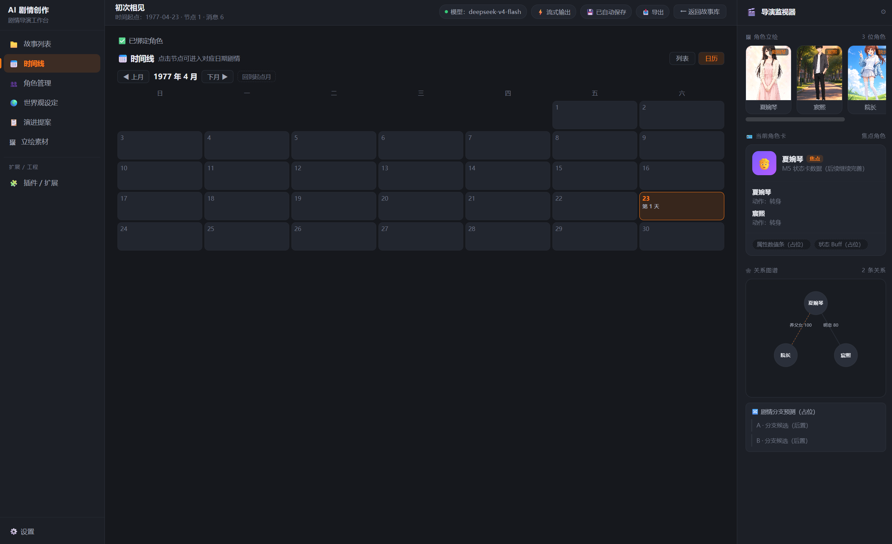
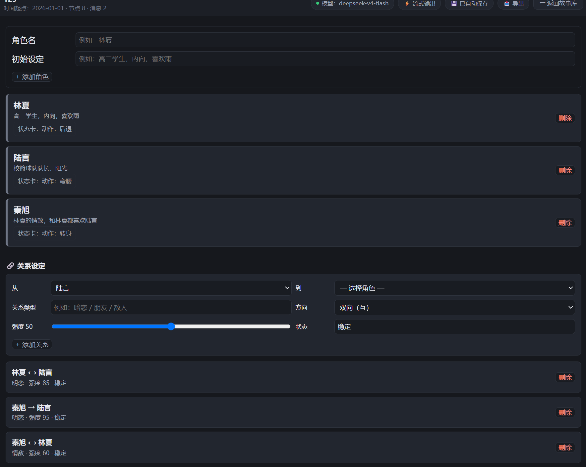
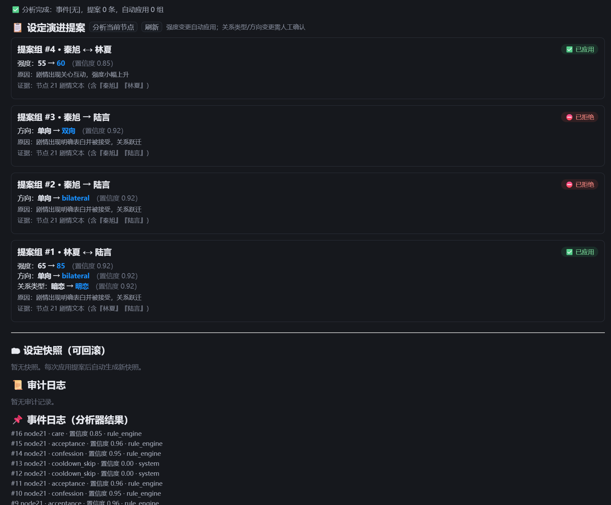
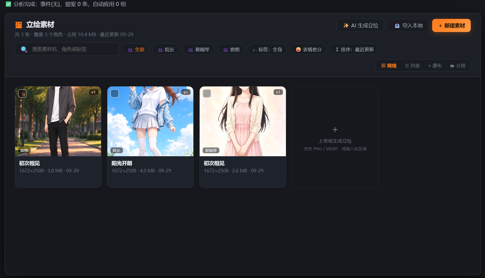

# 织梦机（Story-Weaver）· AI 剧情创作工具

[](https://creativecommons.org/licenses/by-nc-sa/4.0/)
[](#九版本记录)
[](https://tauri.app/)
[](https://react.dev/)
[](https://www.rust-lang.org/)

> **品牌：窗口标题 = 织梦机 · 左栏与打包名 = Story-Weaver**
> **当前版本：V1.9（2026-10-11）· 许可协议：CC BY-NC-SA 4.0（见 [LICENSE](LICENSE) 与 [§十、许可协议](#十许可协议)）**
> **版本规划：V1.x Windows 单机版**
> 端到端最小闭环：创建故事 → 设定时间起点 → 创建角色和世界观 → 写剧情 → 调用模型生成 → 按日保存 → 重启恢复 → 修改历史 → 基于修改续写 → 后台生成设定变更提案 → 人工确认 → 快照更新 → 可回滚。
> 当前阶段：**MVP 开发完成**（M0~M8 回归通过，打包 exe 暂缓）→ 细节打磨完成，立绘素材线（导入/绑定/分组/版本/生成参数/角色立绘联动）已落地 → 详见 §九 版本记录，待办见 PLAN.md §十。

---

## 一、项目简介

面向长文剧情创作的 Windows 单机桌面工具，核心能力：

- **故事与时间线**：绝对时间起点、按日存储、日历视图、插曲/倒叙、历史修改与后续失效标记
- **角色与世界观**：角色库、关系图、世界观硬规则
- **剧情生成**：三重语法（圆括号=动作表情心理 / 双引号=台词 / 裸文本=元指令）、沉浸式/上帝视角双模式、流式输出
- **上下文管理**：系统提示词→角色设定→关系图→世界观→最近 N 轮→用户输入；Token 估算与智能截断（只截断历史、超限自动降 N）
- **后台静默演进**：事件日志 → 候选事件提取 → 实质性判断 → 变更提案 → 校验 → 人工确认/拒绝 → 快照更新 → 可回滚
- **设置与安全**：API Key 存系统钥匙串（不落剧情文件夹）、缓存管理、日志与调试面板

详细规格见《开发期的文档（主参考）》下各文档。

## 二、技术栈（已确认落地）

| 层 | 技术 |
|------|------|
| 桌面壳 | Tauri 2（Rust 核心） |
| 前端 UI | React + TypeScript + Vite（深色 STORY DECK 主题，内联样式） |
| 数据库 | SQLite（sqlx），story.db / library.db |
| 状态管理 | React useState / 组件内状态（未引入状态库） |
| Token 估算 | 前端字符粗估 + N 值自适应降级 |
| 网络 | reqwest + tokio |
| 钥匙串 | keyring（Windows Credential Manager） |
| 云端模型 | OpenAI-compatible（DeepSeek 已验证） |
| 分析器 | Rust 规则引擎（段落归属 + 代词回指） |

> 注：早期原型曾用 Electron + 原生 HTML/CSS/JS，已废弃重规划；Tailwind CSS / Zustand / tiktoken-rs 曾在规划中提及，最终未落地（Token 为粗估）。

## 三、当前状态

- ✅ **M0~M7**：骨架/SQLite/钥匙串、故事角色世界观关系 CRUD、DeepSeek 真 API 流式生成、时间线按日存储、上下文管理与请求快照、状态提取与状态卡、后台静默演进（提案/快照/审计/回滚/缓存）
- ✅ **M8 回归**：全模块回归通过；打包 exe 暂缓（用户拍板）
- ✅ **细节打磨**：剧本排版、旁白/对话模式、输入台四控件、@角色/#标签、日历模块、关系图谱、导出（txt/md/html 粒度+格式）、首页空白化、立绘素材线（页面四视图/导入/新建/角色绑定/批量操作/角色可编辑/版本历史/生成参数/分组聚合/角色立绘联动）
- ✅ **V1.3（2026-10-02）**：品牌更名（窗口壳=织梦机 / 左栏与打包名=Story-Weaver）；关系图谱改父节点中心两层布局（角色 chips 可切换父节点）；焦点角色详情卡（点击右侧立绘切换焦点 + 关系摘要 + 状态徽章，未绑定占位卡也可点击）；状态提取并入最新用户输入；插件占位「JEV 评估判断模型」改名「评估判断模型」
- ✅ **生成参数页（2026-10-02）**：左侧导航「生成参数」位于「立绘素材」下方；Token 预算（请求快照拆分 + 装配清单 / 裁剪优先级）、Prompt 预览（按来源分色 + 复制完整 Prompt）、立绘参数（三栏排版，素材参数写回）、JSON（最近请求完整 JSON）四页签；快照默认跟随当前时间线节点、可下拉切换；N 按「条消息」显示；AI 生图 / LoRA / denoise 仍后置；后端已修复当前输入重复进入上下文；对话区输入台右下角同步显示当前节点 Token 预算占比
- ✅ **角色管理页 A/D/G（2026-10-02）**：A=3 列角色卡墙（立绘/定位/状态条 + 体力/理智/情绪/戏份 + 出场节点/台词/立绘数）；D=关系网络（网络图 + 关系条目，description/evidence 可编辑）；G=新建/编辑表单（完整字段 + 立绘预览 + 空态/骨架/异常态）；后端扩 characters/relations 表，新增 update_character / update_relation / character_usage；D 关系网络中心角色可切换；立绘绑定按故事隔离；定位新增「未定位 / 男主 / 女主」；关系网络定位标签避让连线；关系注入 AI 改为「A 是 B 的『X』」句式；双向关系自动拆成两条单向（亲属词按性别/年龄判长辈，同性按年龄，兜底取 from，空类型默认陌生人），仅命中亲属关键词的双向关系条目可展开；新建/编辑角色性别必填（红色 *）
- ✅ **世界设定 E/F/C/G（2026-10-02）**：E 地图与地点（SVG 图钉 + 地点清单联动）、F 势力卡片 + 关系矩阵、C 术语词典表、G 冲突检测（同 key 多表述 + 空态/骨架）；world_settings 加 category/meta_json；Prompt 按分类注入地点/势力/术语/势力关系；主色为中文颜色；冲突检测当前仅覆盖地点坐标重复（设定条目检测后置）
- ⏳ 后置：打包 exe、剧情分支预测、关系图谱双向反向虚线、Ollama 等插件系统、AI 生成立绘、表情差分/主色卡（详情页占位）

## 四、目录结构

```
D:\project\ai生成\
├─ app\ · resources\ · config\          # 程序/资源/全局配置
├─ library\                              # 故事库（library.db + projects + shared + backups + trash）
├─ plugins\ · models\ · cache\ · logs\  # 插件/本地模型/缓存/日志
├─ backups\ · temp\ · exports\          # 备份/临时/导出
├─ docs\                                 # 项目文档（开发期的文档（主参考））
├─ screenshots\                          # 界面截图（README 展示用）
├─ 规则\                                 # 规则类文档（ai输出规则）
├─ README.md                             # 项目总览（本文件）
└─ STORAGE.md                            # 存储与数据规划
```

> 完整目录树与数据映射见 STORAGE.md。

## 五、界面展示

| 界面 | 截图 |
|------|------|
| 对话区（剧本渲染：旁白淡灰 / 台词角色标签 / 动作斜体） |  |
| 时间线（列表 / 日历月视图，节点标签与插曲） |  |
| 角色管理（角色 CRUD + 关系设定） |  |
| 世界观设置（条目 + 硬规则标记） |  |
| 演进提案（确认 / 拒绝 / 回滚 / 事件日志 / 快照） |  |
| 立绘素材（网格视图 + 批量操作 + 分组 + 详情） |  |

## 六、环境要求（规划）

- Rust 工具链（Tauri 2 需要）+ Node.js ≥ 20 + npm
- Git（当前 2.55.0，便携版 D:\tools\Git，已入用户 PATH）
- Ollama 已安装（PATH 含 D:\ai\ollama，供本地模型）

## 七、启动方式

```bash
cd D:\project\ai生成
npm install        # 首次
npm run tauri dev  # 开发模式启动（前端 + Rust 后端）
```

- 应用数据落在根目录：library\default\projects\<故事>\story.db（每故事独立库）、library.db（故事索引）
- API Key 存 Windows 系统钥匙串，不落项目目录
- git 仅本地管理（身份 gu-chen-xi），提交前需用户确认

## 八、文档导航

| 文档 | 位置 | 职责 |
|------|------|------|
| README.md | 根目录 | 项目总览（本文件） |
| STORAGE.md | 根目录 | 存储与数据规划（目录树/数据映射/导出位置） |
| SPEC.md | docs\开发期的文档（主参考） | 产品规格 |
| UI_TREE.md | docs\开发期的文档（主参考） | UI 树：按钮与组件层级 |
| PLAN.md | docs\开发期的文档（主参考） | 开发计划、逻辑因果、状态流转 |
| 主界面设计方案.md | docs\开发期的文档（主参考） | 设计全文存档 + 用户决策 |
| 开发流程.md | docs\开发期的文档（主参考） | 阶段进度、git 迭代记录 |
| 开发规范.md | docs\开发期的文档（主参考） | 开发约定与硬约束 |
| ROADMAP.md | docs\开发期的文档（主参考） | 后续开发总流程、批次计划、待定问题（当前入口） |
| 测试用例.md | docs\开发期的文档（主参考） | 后台静默演进完整用例 + 边界 |
| 最小MVP实现.md | docs\开发期的文档（主参考） | MVP 全规格（数据模型/模块/页面/验收） |
| AI输入输出规则.md | 规则\ai输出规则 | 用户输入规则 + AI 输出固定格式 |

> 上下文恢复入口（按此顺序读）：[最小MVP实现.md](docs/开发期的文档（主参考）/最小MVP实现.md) → [PLAN.md](docs/开发期的文档（主参考）/PLAN.md) → [UI_TREE.md](docs/开发期的文档（主参考）/UI_TREE.md) → [测试用例.md](docs/开发期的文档（主参考）/测试用例.md) → [STORAGE.md](STORAGE.md) → [AI输入输出规则.md](规则/ai输出规则/AI输入输出规则.md)

## 九、版本记录

| 版本 | 日期 | 内容 |
|------|------|------|
| V1.9 | 2026-10-11 | **跨天记忆与上下文预算体系**（ROADMAP 第一批 A/B/C/D）：① 上下文预算可配置 —— 设置 › API 新增「上下文窗口」（默认档预设 + 低值告警）、「预算系数」（0.8）、「单次最大输出」、「每日上限」，后端把硬编码 4800 拆成 max_tokens + 安全余量并抽出统一函数（含单测）；② 日摘要 —— `timeline_nodes.day_summary` 存每天摘要，翻篇后幂等补齐、正在写的这天在 AI 回复达 10 条时自动刷新，时间线显示 📝 标记与摘要卡片、可手动重新生成（覆盖需二次确认），并预留 `story_summaries` 阶段摘要表；③ 跨天历史装配 —— 近 3 个天数节点取原文（插曲/倒叙不算天数），更早的天以日摘要进 system 的【前情提要】；历史每天首条带「【第 N 天】」标记；每日条数 N 由「历史可用预算 ÷ 保留天数 ÷ 单条均 token」倒推（不写死），四级阶梯降级（封顶 → 整天移出原文区改摘要 → 逐条降 N → 摘要区按最旧丢弃）；④ 时间流逝 —— 时间线列表/日历/剧情区三处显示「⏳ 时间流逝 · 第 N~M 天（无事件）」区间条，点击可在空白期插入事件节点（不插入则不建节点）；⑤ 预算展示 —— 「生成参数 › Token 预算」新增「🧮 本次预算口径」与「📐 每日 N 值」（默认档 32k 与当前设置并排，给出 N 值理论上限与封顶后取值），请求快照新增 tail_block / context_window / reserve_ratio / max_tokens / safety_margin / input_budget / day_window / day_n / n_value / avg_msg_tokens 字段；⑥ 修复 —— 「下一天」按节点个数算天数导致跳号时算错（改为最大天数 +1）、本次输入被重复追加（比对未剥导演指令标记）
| V1.8 | 2026-10-10 | 提示词重排为「稳定前缀 + 上下文更新尾部块」（为前缀缓存省钱 / 降首字延迟）：system 只留稳定内容（基础指令+输出排版 / 数据字典 / 世界观 / 角色 / 方向和关系）；「上下文更新」块（当前模式 / 篇幅 / 数值与状态 / 聚焦 / 约束 / 时空 / 导演指令）每轮现拼、并入本次用户消息（分隔线区分）、不落库不进历史。关系拆两段：方向和关系进 system、数值与状态进尾部块（带「以本节为准」覆盖声明）；两段关系读法合并为【数据字典】。修复本次输入被重复追加（历史已剥导演指令标记、比对未剥，导致同一条输入进入请求两次）。调试快照新增 `tail_block`，「生成参数」三页签与「请求日志」分区显示（历史消息剔除块）。同步 UI_TREE.md（V3.20）与 AI输入输出规则.md（v0.8，含块机制与两层验证口径） |
| **V1.7（正式发布）** | 2026-10-08 | **许可协议由 MIT 变更为 CC BY-NC-SA 4.0**；版本号三处对齐（package.json / tauri.conf.json / Cargo.toml = 1.7.0）；标识符改为 com.guchenxi.story-weaver；Git 历史合并为单条发布提交。功能侧：左导航二级层级缩进、故事列表宽度自适应、整卡点击交互统一（故事卡 / 时间线 / 角色卡 / 设定条目 / 势力卡 / 术语行）、输入台溢出修正与篇幅两挡（简单 / 详细）、对话区新增心声渲染（`*……*`）、提示词体系改写（角色扮演引擎 / 关系强度档位 / 状态含义 / 方向读法 / 导演指令 / 心理描写规则）、角色年龄标注与势力关系孤儿清理、扮演角色按故事校验 |
| V1.6 | 2026-10-02 | 世界设定页按 E/F/C/G 重做：地图地点 / 势力矩阵 / 术语词典 / 冲突检测；world_settings 扩 category/meta_json；新增 update_world_setting / detect_world_conflicts |
| V1.5 | 2026-10-02 | 角色管理页按参考 A/D/G 重做：角色卡墙 / 关系网络 / 新建编辑表单；characters 扩 13 列（别名/定位/阵营/年龄性别/首次出场/身份/说话方式/性格 + 四条属性）；relations 扩 description/evidence；新增 update_character / update_relation / character_usage；D 关系网络中心角色可切换；立绘绑定按故事隔离；定位新增「未定位 / 男主 / 女主」；关系网络定位标签避让连线；关系注入 AI 改为「A 是 B 的『X』」句式；双向关系自动拆成两条单向（亲属词按性别/年龄判长辈，同性按年龄，兜底取 from，空类型默认陌生人），仅命中亲属关键词的双向关系条目可展开；新建/编辑角色性别必填（红色 *） |
| V1.4 | 2026-10-02 | 新增「生成参数」页：左导航位于「立绘素材」下方；Token 预算 / Prompt 预览 / 立绘参数 / JSON 四页签；数据源=请求快照 debug_requests + portraits 素材参数；快照默认跟随当前节点、可切换；N 按条显示；修复当前输入重复入上下文；对话区输入台显示当前节点 Token 占比 |
| V1.3 | 2026-10-02 | 品牌更名（窗口壳=织梦机 / 左栏与打包名=Story-Weaver）；关系图谱父节点中心两层布局（可切换父节点）；焦点角色详情卡（立绘区点击切换 + 关系摘要 + 状态徽章）；状态提取并入用户输入；插件占位改名「评估判断模型」 |
| V1.2 | 2026-09-29 | 立绘素材线完成：导入/新建/绑定、批量操作（分组/标签/导出/删除）、角色可编辑、版本历史、生成参数、分组视图聚合、角色立绘联动；返回故事库清空角色列表；滚动条半透明；补 LICENSE + .gitignore；准备首次上传 GitHub |
| V1.1 | 2026-09-27 | MVP 开发完成（M0~M8 回归通过，打包暂缓）+ 细节打磨（导出/日历/关系图/四控件/首页空白化/立绘素材页）；文档同步 |
| V1.0（规划） | 2026-09-21 | 推倒重规划：清空旧 Electron 实现，重建文档体系（STORAGE 目录规划 / MVP 全规格 / 测试样板） |
| v0.1 | 2026-09-08 | 旧 Electron 原型（已废弃） |

## 十、许可协议

本项目自 **V1.7（2026-10-08）** 起采用
**[CC BY-NC-SA 4.0](https://creativecommons.org/licenses/by-nc-sa/4.0/)**（署名—非商业性使用—相同方式共享 4.0 国际）协议，全文见 [LICENSE](LICENSE)。

- ✅ 可以：个人学习、研究、非商业用途的修改与再分享（需署名 + 相同协议）
- ❌ 不可以：任何以商业优势或金钱报酬为主要目的的用途
- ⚠️ 说明：本仓库历史提交（2026-09-22 ~ 2026-10-08）曾以 MIT 协议发布，此前的 MIT 授权对已获得该等副本的人继续有效；本变更仅适用于 V1.7 及今后版本。
- 第三方依赖（Tauri / React 等）仍遵循其各自协议。
